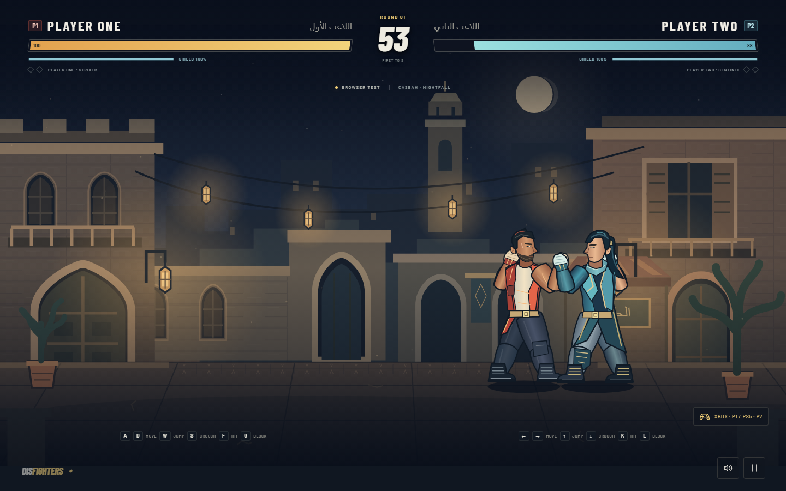
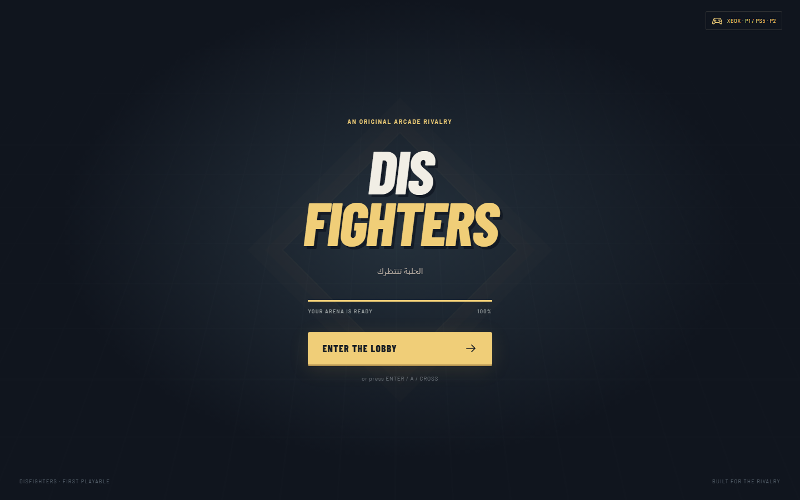
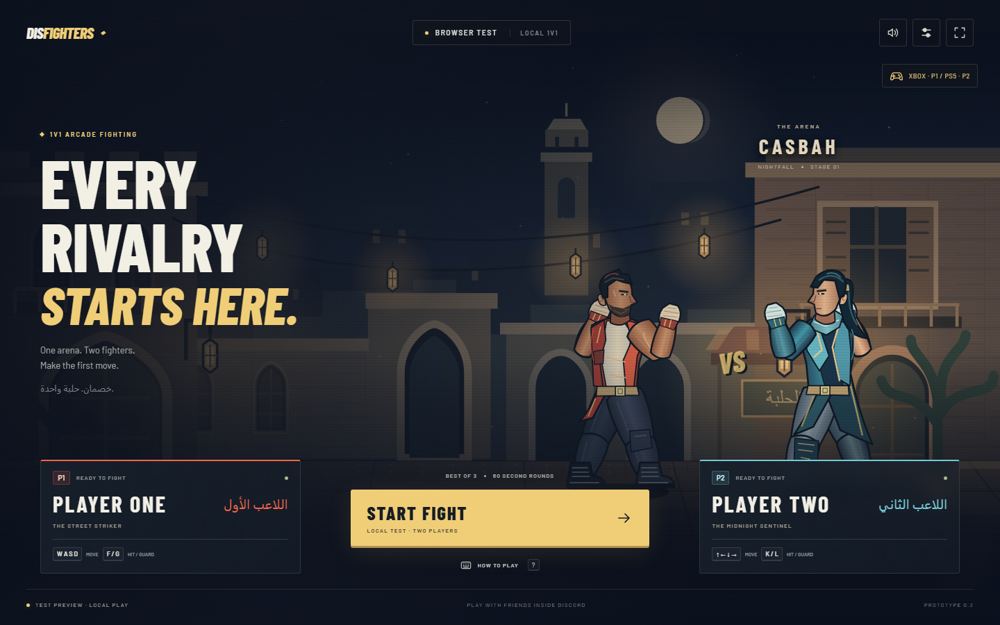
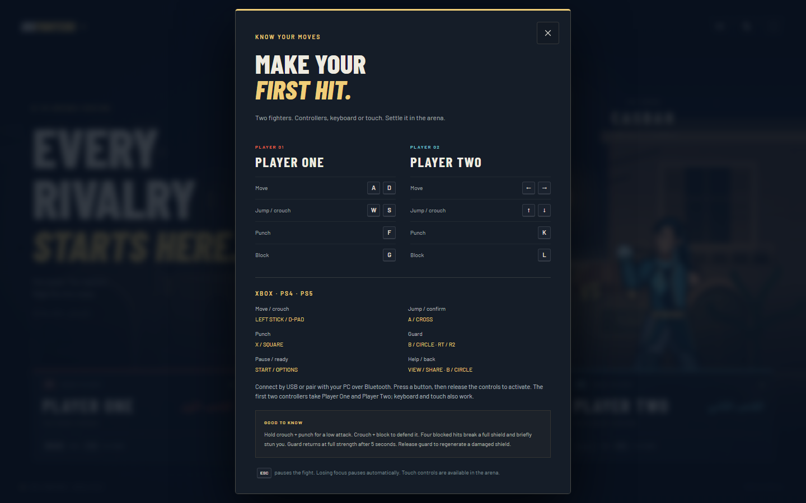
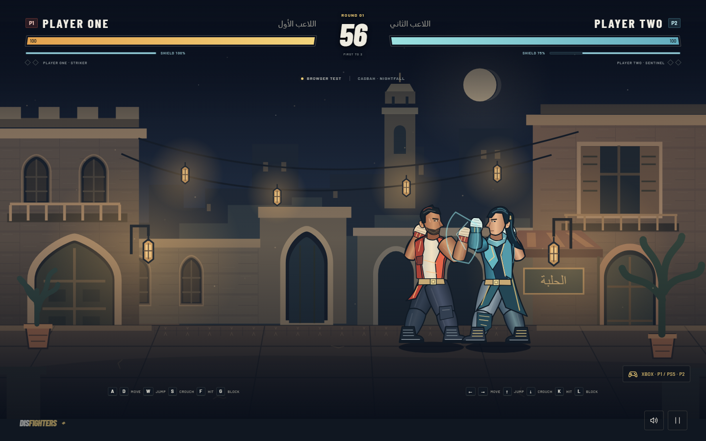
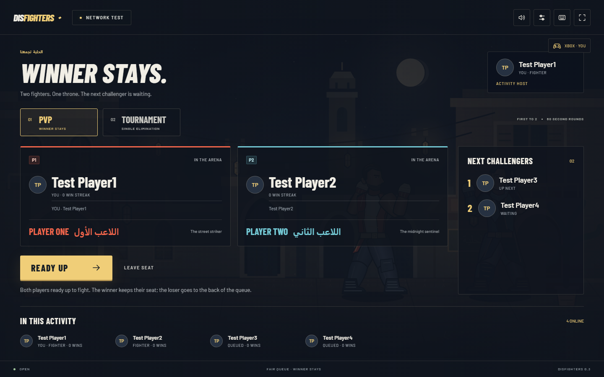
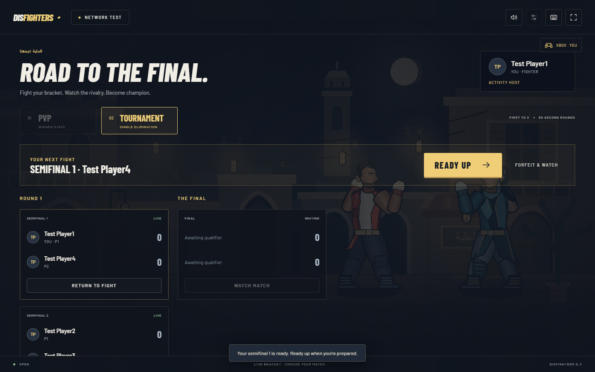

# DisFighters

A full-screen 2D fighting-game prototype built with Ludicord 4.1.1.
Loading → Discord lobby → PvP queue or tournament → real-time 1v1 → results.
Discord authentication is required. Browser development is for testing only.

## What you can play

- Full-screen loading, lobby, arena and results, with original fighters and an Arabic-inspired night arena.
- Real-time Discord 1v1 with verified profiles, spectating and server-owned combat rules.
- Winner-stays PvP with a FIFO challenger queue, session wins and streaks.
- 2–16-player single-elimination tournaments, concurrent matches and a watchable bracket.
- Xbox, PS4 and PS5 standard-mapped controllers on PC, keyboard and mobile touch controls.
- Configurable rounds, destructible shields, pause coordination and reconnect reservations.

This is a first-playable prototype. Sessions run in memory on one server; persistent
rankings, rollback netcode and distributed hosting are not implemented.

## Screenshots

These are actual development captures. Network screenshots use test identities;
controller screenshots use virtual Gamepad devices. They do not demonstrate a
physical controller or a live Discord iframe test.



| Loading | Game lobby |
| --- | --- |
|  |  |

| PC controller guide | Shield combat |
| --- | --- |
|  |  |

| Winner-stays PvP queue | Tournament bracket |
| --- | --- |
|  |  |

[Mobile arena](docs/screenshots/mobile.png) ·
[Round settings](docs/screenshots/settings.png) ·
[Tournament registration](docs/screenshots/tournament-lobby.png)

## Installation

### Requirements

- Node.js **20.19 or newer** and npm; use an active supported Node LTS release.
- Git and a modern browser. Chromium is used for automated browser checks.
- For real multiplayer: a Discord application, Activity configuration and a public
  HTTPS endpoint that supports WebSockets.

```bash
git clone https://github.com/mrcholer/DisFighters.git
cd DisFighters
npm ci
```

Create your local environment file:

```bash
# macOS / Linux
cp .env.example .env.local
```

```powershell
# Windows PowerShell
Copy-Item .env.example .env.local
```

For Discord play, fill in the values described below. Generate a session secret with:

```bash
node --input-type=module -e "import { randomBytes } from 'node:crypto'; console.log(randomBytes(32).toString('hex'))"
```

Keep `.env.local` private. It is ignored by Git. Use a stable session secret on your
production server; replacing it invalidates existing sessions.

| Variable | Purpose |
| --- | --- |
| `LUDICORD_DISCORD_CLIENT_ID` | Discord application ID |
| `LUDICORD_DISCORD_CLIENT_SECRET` | Server-only OAuth client secret |
| `LUDICORD_SESSION_SECRET` | Random session encryption secret, at least 32 characters |
| `LUDICORD_DISCORD_PUBLIC_KEY` | Application public key used by framework verification features |
| `LUDICORD_DISCORD_BOT_TOKEN` | Optional server-only bot token for automatic Activity instance verification |
| `LUDICORD_DEV_*` | Optional fake identities for local development only; see `.env.example` |

### Run the browser preview

```bash
npm run dev -- --port 3173 --host 127.0.0.1
```

Open `http://127.0.0.1:3173/?test=local` for the labelled **Browser test**. Two local players
share one keyboard or use two controllers; touch controls are available on smaller screens. This
development preview does not authenticate real Discord players. Production
rejects outside-Discord play and development sessions.

| Action | Player One | Player Two |
| --- | --- | --- |
| Move | A / D | Left / Right arrows |
| Jump | W | Up arrow |
| Crouch | S | Down arrow |
| Punch | F | K |
| Block | G | L |
| Pause / resume | Escape | Escape |

Get close enough to land a punch. Hold crouch + punch to attack low; crouch +
block to defend a low attack. Jumping can evade strikes or cross over an opponent.
A held punch key performs one attack: release it before punching again.

Use **Match settings** in the lobby to choose 30, 60 or 90 seconds per round and
first to 1, 2 or 3 wins. Defaults are 60 seconds and first to 2. A simultaneous
knockout or equal health at timeout is a draw and gives neither player a point.
Losing window focus pauses play and clears held controls. Pausing freezes the
simulation; resume explicitly when returning. **Restart match** resets the score.

Guard has 100 strength and loses 25 per blocked hit. The fourth blocked hit
breaks a full shield, briefly stuns the defender and disables guard for 5 seconds.
The breaking hit is absorbed; later hits damage health. The shield returns full
after the cooldown. A partially damaged shield regenerates at 20/sec after
1.5 seconds without a blocked hit while guard is released. Pausing freezes recovery.

The two fighters and arena are original illustrated art. Combat uses a fixed
120 Hz local simulation and Ludicord's `useGameLoop()` for rendering. Rules,
rendering, audio, and React game flow live in separate modules. The Barlow fonts
are bundled locally with their SIL Open Font License in `public/fonts/OFL.txt`.
Game art is local. Discord portraits load through `/api/avatar`, a same-origin
endpoint restricted to public Discord avatar paths. It resizes portraits to 128px,
coalesces concurrent requests, caps image size/concurrency, and caches up to 64
images for a day. Failed portraits fall back to the player's initials. No copied
characters or public matchmaking are included.

## PC controllers

Xbox, PS4 (DualShock 4), and PS5 (DualSense) controllers use the browser's
standard Gamepad mapping. Connect by USB or Bluetooth, press a button so the
browser detects the controller, then release the buttons and stick. The in-game
controller status shows the assignment and any unsupported mapping or blocked
access. Hardware and browser combinations still need a physical controller test.

| Action | Xbox | PlayStation |
| --- | --- | --- |
| Move / menu navigation | Left stick or D-pad | Left stick or D-pad |
| Jump / confirm | A | Cross |
| Crouch | Stick / D-pad down | Stick / D-pad down |
| Punch | X | Square |
| Guard / menu back | B or RT (guard) | Circle or R2 (guard) |
| Pause / resume / ready | Menu / Start | Options |
| Controls in lobby | View | Share / Create |

In the local browser test, the first controller controls P1 and the second P2.
Unplugging P1 leaves P2 in its seat; a replacement controller takes the free seat.
Inside Discord, the first controller controls your authenticated fighter in
either seat. Extra controllers stay on standby, and spectators cannot send
combat input or pause a fight.

A 30% stick dead zone limits drift. Held punch and menu buttons require release
before another action. After entering a fight, pausing, reconnecting, or returning
to the window, release controls before playing. Unplugging an assigned controller
pauses an active fight; in Discord both fighters must confirm resuming. Menus can
be operated by controller, and actions such as forfeit or restart require moving
focus to their button before confirming. Keyboard and touch remain available if
a controller's mapping is unsupported or Gamepad access is blocked by its frame.

Automated coverage uses virtual standard-mapped controllers, including sparse
browser slots, two local controllers, online P2 input, spectator rejection,
hot unplug, focus loss, and menu navigation. Physical USB/Bluetooth controllers
and the live Discord Activity frame have not yet been tested.

## Checks

```bash
npm run test:rules
npx ludicord routes
npx ludicord lint
npx tsc --noEmit
npm run build
npm run test:browser
npm run test:production
```

Browser tests use Chromium installed inside `.cache/playwright` in this project.
Install it with `npm run browser:install`. Test diagnostic screenshots go into `.artifacts`. The publishable gallery is in
`docs/screenshots`; regenerate it with `npm run screenshots`.
On a constrained PC, run `npm run test:browser -- --trace off` to avoid recording
several animated clients at once. Trace recording remains available for diagnosis.

## Inside Discord

1. Create an application in the [Discord Developer Portal](https://discord.com/developers/applications),
   enable Activities, and fill `.env.local` with its application ID and client secret.
   In OAuth2 settings, add the SDK placeholder redirect URI `https://127.0.0.1`.
   Enable Discord Developer Mode to test your application.
2. Run the development server and expose port 3173 through an HTTPS tunnel. Set
   the Activity URL mapping prefix to `/` and its target to your tunnel hostname
   without `https://`. The root mapping covers `/ws/duel` and `/api/avatar`.
   Follow [Discord’s Activity setup guide](https://docs.discord.com/developers/activities/building-an-activity)
   for application installation and launch settings. Avatars use the root mapping,
   without a separate CDN mapping. [Discord's networking guide](https://docs.discord.com/developers/activities/development-guides/networking)
   explains the Activity proxy restrictions.
3. Launch this Activity in Discord. Invite a second player into the **same Activity**.
   Names, avatars and player IDs come from verified Ludicord sessions. **YOU**
   marks your profile. Player One and Player Two identify the fighter slots.
4. The first connected player hosts the Activity and sets its mode and round rules.
   Host ownership passes to the earliest remaining connected player if they leave.
   Both fighters choose **Ready up**.
   Each player controls only their own fighter with WASD/F/G, arrows/K/L, or their connected controller.
5. Both players confirm each next round. Either fighter can pause; both must
   confirm resuming. Browsing the lobby during your fight pauses it. **Forfeit &
   watch** explicitly concedes the match. Spectators cannot pause or control it.

### PvP — winner stays

The first two connected identities occupy P1 and P2 in join order. Later players
watch and can **Join queue**, or take an empty seat. Seats always fill from the
queue first. After a full duel, the winner stays in the same seat; the next
challenger arrives after a six-second results display. The loser returns to the
back of the queue unless they withdrew. A fresh duel resets health, shields,
rounds and score, and requires both fighters to ready up. Queue positions, session
wins and win streaks appear in the lobby. **Leave queue** changes you to a spectator.

### Tournament — single elimination

Switch modes before play starts. Players opt into registration; the host starts
with 2–16 connected entrants. Seeds follow Activity connection order, with balanced
byes when needed. Pairings run simultaneously. Winners advance when their next
opponent qualifies, until a champion wins the final. Rules and modes are locked
while the tournament runs. The host can open a new registration after the final.

**View bracket** opens the match browser. Spectators, eliminated players and
waiting winners can watch any active or completed fight in this Activity. An
active fighter must finish or forfeit before watching a different match. New
pairings send both entrants a notice. No replays are stored; a completed match
shows its final state. All wins and brackets belong to this running session.

The `/ws/duel` route runs the authoritative rules on one Node process. Clients
send bounded controls with sequence numbers, an arena ID and a match generation; identity and
Activity isolation come from the session, never a packet's user/room fields.
The server broadcasts snapshots at 20 Hz; clients interpolate positions. Inputs
expire after 350 ms without renewal. Disconnects pause and reserve the fighter
slot for 30 seconds. Reconnection restores the current match and needs both
players to resume. An expired reservation forfeits only that pairing to a
connected opponent. If both players are absent, no winner is invented. Queue
entries disappear on disconnect. Duplicate windows for the same user replace the
earlier connection without creating a second seat or bracket entry.

State is in process memory. Server restart or development hot replacement resets
matches. Run one server process; distributed rooms, durable rankings and rollback
netcode remain future work. Configure the optional server-only bot token for
Ludicord's automatic Activity instance verification when available.
The current `allowedHosts: true` is preserved from the project's configuration;
set an explicit production/tunnel hostname list before deployment. Without the
bot token, Discord user authentication still runs, but automatic server-side
Activity instance verification is inactive.

## Network testing

`npm run test:browser` starts a development server with a test-only session secret.
Tests create separately encrypted, development-marked sessions and exercise up to
five independent clients: identity/portrait UI, FIFO winner rotation, parallel
tournament matches, waiting-winner spectating, final advancement, instance
isolation, reconnect and unauthenticated upgrades. They perform actual knockouts
through keyboard input. These sessions are never accepted by production. The
suite also validates local combat, touch controls and round settings; rule tests
cover 3/5/8/16-player brackets, forged inputs, grace expiry and avatar cache limits.

For manual development fake login, use the optional `LUDICORD_DEV_*` settings in
`.env.example`. `?test=local` selects the local test when a fake login is enabled;
it has no effect inside Discord or on production authentication.

Real Discord OAuth and iframe validation require the application's credentials
and public URL mapping. See `DESIGN.md` for state ownership and scope.


## Production deployment

DisFighters needs a long-running **Node server with WebSocket support**. Serve the
frontend and `/ws/duel` from the same deployment. Static-only hosting cannot run
the multiplayer server.

1. Set production environment variables using your hosting provider's secret store.
2. Replace `server.allowedHosts: true` in `ludicord.config.mjs` with your explicit
   public/tunnel hostname allowlist before exposing the server.
3. Install locked dependencies and build:

   ```bash
   npm ci
   npm run build
   npm run start -- --host 0.0.0.0 --port 3173
   ```

4. Put HTTPS in front of the server, forward WebSocket upgrades, and update the
   Discord root URL mapping to your production hostname.
5. Run one application process. Multiple workers do not share queues, brackets or
   matches. A restart discards all running competitions.
6. Test two real Discord users in the same Activity, another Activity for room
   isolation, reconnect/resume, spectators and physical controllers before release.

Production requires Discord authentication (`auth.required: true`). Development
fake sessions and `?test=local` never unlock production combat. The supplied
configuration uses `proxyVerification: false` and automatic Activity instance
verification; without the optional bot token, user authentication still works but
server-side Activity instance verification is inactive. Review these settings for
your deployment using the [Ludicord docs](https://ludicord.extra.codes/docs).

## Project structure

| Path | Responsibility |
| --- | --- |
| `app/page.tsx`, `components/disfighters.tsx` | Activity entry, asset loading and screen flow |
| `components/arena.tsx`, `canvas-scene.tsx` | Combat presentation and rendering loop |
| `components/competition-lobby.tsx` | Verified profiles, queues, tournaments and watch controls |
| `lib/game/engine.ts` | Deterministic combat, rounds, shields and bounded inputs |
| `lib/game/duel-room.ts`, `competition.ts` | Server-owned room lifecycle and tournament progression |
| `lib/game/use-duel.ts`, `protocol.ts` | WebSocket client and snapshot protocol |
| `lib/game/gamepads.ts`, `use-gamepads.ts`, `controller-menu.ts` | Controller assignment, polling and menu input |
| `app/ws/duel/socket.ts` | Authenticated multiplayer route |
| `app/api/avatar/route.ts`, `lib/server/` | Bounded Discord portrait proxy/cache |
| `public/` | Original arena, icons and bundled fonts |
| `tests/` | Rule, browser, network and production-auth checks |
| `DESIGN.md` | Game design and state ownership |

## Troubleshooting

- **Discord sign-in required in a normal browser:** production is intentionally
  restricted to Discord. Use `npm run dev` and `?test=local` for browser testing.
- **No multiplayer in the local preview:** local P1/P2 share the browser. Real
  online seats require authenticated users inside the same Discord Activity.
- **Controller not detected:** press a button, release it, check the controller
  status and browser's standard Gamepad mapping. Try USB or another browser.
  An iframe's permissions can prevent Gamepad access; keyboard/touch remain usable.
- **Fight paused after focus loss/unplug:** release controls and confirm resuming;
  online matches require both fighters' confirmation.
- **Socket or assets blocked in Discord:** check the root URL mapping, HTTPS,
  origin/host configuration and reverse proxy WebSocket forwarding.
- **Build gets a Windows file-lock error:** stop the project's development server
  before building, then retry.

## Contributing and license

Open an [issue](https://github.com/mrcholer/DisFighters/issues) with reproduction
steps, browser/OS and controller model when relevant. Keep changes focused and run
the appropriate checks above. Never commit credentials or real session cookies.
For a new controller mapping, include its browser Gamepad ID/mapping and a physical
hardware test when available.

Source and original game art are licensed under [MIT](LICENSE). The bundled Barlow
fonts retain their [SIL Open Font License](public/fonts/OFL.txt). Xbox and PlayStation
names describe compatible input devices; this project is independent of their vendors.
